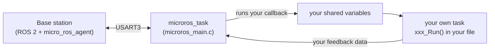

# Kratos Rover Firmware (STM32H753 + FreeRTOS + micro-ROS)

This is the **skeleton firmware** for the rover motherboard. The hard parts are already done:

- FreeRTOS starts and all tasks are created,
- the board connects to the ROS 2 computer over UART and **reconnects by itself**,
- the watchdog is handled.

## What YOU have to do (the whole job)

1. **Subscribers:** add them in **`microros_main.c`**, inside **your own marked blocks** (named after your task: `MOTOR`, `ARM`, `LD`, ...).
2. **Publishers:** put them **wherever you find it easier**:
   - **Option A:** in `microros_main.c`, in the same blocks as your subscriber, or
   - **Option B:** in **your own file**, using three small hook functions that are already called for you.
3. **Task logic** (motors, sensors, ...): write it in `xxx_Run()` in **your own file**.
4. If you need a new data field, **write its name and datatype in the [message table](#4-the-one-custom-message)** and tell the team lead.
5. **Do not touch anything else**, including other people's blocks.

---

## Table of contents

1. [Rules](#1-rules)
2. [How it works](#2-how-it-works)
3. [Which files are yours](#3-which-files-are-yours)
4. [The one custom message](#4-the-one-custom-message)
5. [Where your code goes](#5-where-your-code-goes)
6. [Hardware tips](#6-hardware-tips)
7. [Stack size and debugging](#7-stack-size-and-debugging)
8. [Testing with a Linux PC](#8-testing-with-a-linux-pc)
9. [Team lead notes](#9-team-lead-notes)
10. [Checklist before you push](#10-checklist-before-you-push)
11. [Glossary](#11-glossary)

---

## 1. Rules

| # | Rule | Why |
|---|------|-----|
| 1 | **Only edit your own `.c` / `.h` files and your own blocks in `microros_main.c`.** | Everyone works at the same time. Touching other files or other people's blocks causes Git conflicts and breaks their work. |
| 2 | **Never write `for(;;)` or `while(1)` in your functions.** Each function does one short job and **returns**. | The loops already exist elsewhere. A loop in your code freezes the rover. |
| 3 | **No `HAL_Delay()`, no waiting loops.** | A task that never gives up the CPU freezes every task below it. |
| 4 | **Callbacks must be tiny:** copy the data and return. | Callbacks run inside the micro-ROS task. A slow callback drops the connection and the watchdog resets the board. |
| 5 | **Never call `WDG_FEED()` / `HAL_IWDG_Refresh()`.** | The watchdog only works if just one place feeds it. |
| 6 | **Never use `printf` or `HAL_UART_Transmit` on `huart3`.** | USART3 is the micro-ROS link. Any extra byte breaks it. |
| 7 | **No `malloc` / `free`.** Use `static` or global variables. | Memory fragmentation kills long-running firmware. |
| 8 | **Build before every push.** | A broken `main` branch blocks the whole team. |

---

## 2. How it works



Each person owns **one task** and **one file**. Tasks do **not** talk to each other.

| Piece | Where you write it | Runs in |
|-------|--------------------|---------|
| **Subscriber** (variables, callback, create, destroy) | `microros_main.c`, your own block | micro-ROS task |
| **Publisher** | **Option A:** `microros_main.c`, your own block. **Option B:** your own file (hook functions) | micro-ROS task |
| **Hardware logic** `xxx_Run()` | your own file | your own FreeRTOS task |

(`xxx` is your file's prefix, see the table below.)

### The tasks

A task with a higher priority always interrupts a lower one. **Do not change priorities.**

| Task | File | Prefix | Runs your `_Run()` every | Priority |
|------|------|--------|--------------------------|----------|
| `motor_control` (drive) | `motor_control.c` | `motor` | 50 ms | highest |
| `UROS` | `uros.c` | `uros` | 10 ms | high |
| `LD_task` (life detection) | `ld_sensors.c` | `ld` | 100 ms | above normal |
| `microros_task` | `microros_main.c` | - | its own loop | normal (lead only) |
| `oled_battery` | `oled_battery.c` | `oled` | 10 ms | normal |

Arm (`arm_control.c`, prefix `arm`) and sensor polling (`sensor_polling.c`, prefix `sensor`) work the same way. See [Team lead notes](#9-team-lead-notes) for their tasks.

### Who owns what

| File | Owner |
|------|-------|
| `motor_control.c / .h` | @name |
| `arm_control.c / .h` | @name |
| `sensor_polling.c / .h` | @name |
| `ld_sensors.c / .h` | @name |
| `oled_battery.c / .h` | @name |
| `microros_main.c` (outside the task blocks), `rover_msgs/` | team lead |

---

## 3. Which files are yours

Everything is in `Core/Src` (headers in `Core/Inc`).

**YOURS (edit):** your own `.c` / `.h` file from the table above, and **your own blocks inside `microros_main.c`** (named after your task: `MOTOR`, `ARM`, `SENSOR`, `LD`, `OLED`). Nothing else.

**DO NOT TOUCH:**

| File | What it is |
|------|-----------|
| `microros_main.c` (everything **outside** your own blocks) | Main micro-ROS task. Other people's blocks belong to them. |
| `freertos.c`, `main.c` | Task creation and startup |
| `custom_memory_manager.c`, `microros_allocators.c`, `microros_time.c`, `it_transport.c` | micro-ROS memory, time and UART transport |
| `gpio.c`, `hrtim.c`, `i2c.c`, `iwdg.c`, `tim.c`, `usart.c` | CubeMX-generated peripheral setup |
| `stm32h7xx_*.c`, `system_stm32h7xx.c`, `syscalls.c`, `sysmem.c` | Low-level system files |
| `rover_msgs/` | The custom message definition |

> **Need a new pin, timer, or peripheral?** Ask the team lead. It is changed in the CubeMX `.ioc` file, which cannot be merged in Git, so only one person edits it.

---

## 4. The one custom message

The whole project uses **one** custom message type: `rover_msgs/msg/RoverMsg`.
It contains **all the fields of all tasks**. Each person only reads or fills **their own fields** and ignores the rest.

### 4.1 Field table (single source of truth)

**To add a field: add a row to this table (name, datatype, size, who uses it) and tell the team lead.** You do nothing else. The lead updates the `.msg` file.

| Field name | Datatype | Array size | Used by | Direction |
|------------|----------|------------|---------|-----------|
| `arm_cmd` | `float64` | 6 | arm | base → board |
| `steering_controller` | `float64` | 4 | drive (motor) | base → board |
| `velocity_controller` | `float64` | 4 | drive (motor) | base → board |
| *(add yours here)* | | | | |

Direction: "base → board" means the board **subscribes**, "board → base" means the board **publishes**.

### 4.2 Topic table

Choose your own topic names and write them here. **Topic names must be unique.**

| Topic | Message type | Direction | Module |
|-------|--------------|-----------|--------|
| `/arm_cmd` | `rover_msgs/msg/RoverMsg` | base → board | arm |
| `/drive_cmd` | `rover_msgs/msg/RoverMsg` | base → board | motor |
| `/arm_state` | `rover_msgs/msg/RoverMsg` | board → base *(EXAMPLE)* | arm |
| *(add yours here)* | | | |

### 4.3 Datatype rules

| In the field table | In C code |
|--------------------|-----------|
| `bool` | `bool` |
| `uint8` / `int8` | `uint8_t` / `int8_t` |
| `uint16` / `int16` | `uint16_t` / `int16_t` |
| `uint32` / `int32` | `uint32_t` / `int32_t` |
| `uint64` / `int64` | `uint64_t` / `int64_t` |
| `float32` | `float` |
| `float64` | `double` | `custom_status_msg` |

1. **Arrays must have a fixed size:** `float64[6]`, never `float64[]`.
2. **No `string`** or any other variable-length type. Use a number code instead.
3. **The whole message is sent every time**, so total size matters. Keep the **whole** message under about **400 bytes** (about 50 doubles for everyone combined). Use `float32` instead of `float64` when you do not need the precision. Current size: 20 doubles = 160 bytes.
4. Field names: `lowercase_with_underscores`, **unique across the whole message**.

### 4.4 In your C code: accessing the fields

Every field in the `.msg` file becomes a member of the message struct with **the same name**.
The pattern is always:

```
message_variable.field_name[index]
```

```c
#include <kratos_teerth_rohan_pandya_msgs/msg/rover_status.h>

kratos_teerth_rohan_pandya_msgs__msg__RoverStatus custom_status_msg;      /* a message variable (name it anything) */

custom_status_msg.arm_position[0] = 1.5;          /* WRITE element 0 of the field */
double x = custom_status_msg.arm_position[0];     /* READ element 0 */
```

**Rules**

1. **Use the field name exactly as written in the field table / `.msg` file** (case-sensitive, with underscores). A wrong name will not compile.
2. **Indexes start at 0.** An array of size `N` has indexes `0` to `N-1`. For `float64[6]` the valid indexes are `0, 1, 2, 3, 4, 5`. **Index 6 or higher silently corrupts memory.**
3. **A single value (no array) has no index:** `custom_status_msg.my_flag = true;`
4. **Dot or arrow?** A message *variable* uses `.` (`custom_status_msg.arm_cmd[0]`). A *pointer* uses `->`. In a callback, `m` is a pointer, so write `m->arm_cmd[0]`.
5. **You cannot copy a whole array with `=`.** Copy element by element, with a loop, or with `memcpy` (as in the template).

**Cheat sheet: every element, by field name**

In the table below, `msg` stands for your message variable. In a callback, replace `msg.` with `m->`.

| Field name | Datatype | Every element |
|------------|----------|---------------|
| `arm_cmd` | `float64` × 6 | `custom_status_msg.arm_cmd[0]`  `custom_status_msg.arm_cmd[1]`  `custom_status_msg.arm_cmd[2]`  `custom_status_msg.arm_cmd[3]`  `custom_status_msg.arm_cmd[4]`  `custom_status_msg.arm_cmd[5]` |
| `wheel_vel` | `float64` × 4 | `custom_status_msg.wheel_vel[0]`  `custom_status_msg.wheel_vel[1]`  `custom_status_msg.wheel_vel[2]`  `custom_status_msg.wheel_vel[3]` |
| `wheel_angle` *(EXAMPLE)* | `float64` × 4 | `custom_status_msg.wheel_angle[0]`  `custom_status_msg.wheel_angle[1]`  `custom_status_msg.wheel_angle[2]`  `custom_status_msg.wheel_angle[3]` |


**When you add a field to the table in 4.1, also add its row here**, listing each element by name.
## 5. Where your code goes

Your code goes in up to **two files**:

| File | What you write there |
|------|----------------------|
| `microros_main.c` | **Subscribers** (always). **Publishers** too, if you choose Option A. |
| your own file (`arm_control.c`, ...) | `xxx_Run()` (always). **Publishers** too, if you choose Option B. |

In `microros_main.c` there are **4 places**, and in each place there is a block for every task. Every block looks like this:

```c
/* ---- ARM (arm_control.c): globals + callbacks (START) ---- */
        <<< YOUR CODE GOES HERE, between START and END >>>
/* ---- ARM (arm_control.c): globals + callbacks (END) ---- */
```

| Place | Where in the file | What goes in your block |
|-------|-------------------|--------------------------|
| **1. Globals + callbacks** | near the top | subscriber / publisher variables, your callback, your publish function |
| **2. Create** | inside `ros_create()` | `init` of your subscribers / publishers |
| **3. Destroy** | inside `ros_destroy()` | one `fini` for every `init` from place 2 |
| **4. Publish calls** | inside the connected loop | call your publish function (Option A only) |

> **Only type between your own START and END lines.** Never touch another task's block or the code between blocks.

The examples below use the **ARM** task and the `arm_cmd`  fields. Replace `arm` with your own prefix and the fields with yours (see [4.4](#44-in-your-c-code-accessing-the-fields)).

### 5.1 Subscriber (in `microros_main.c`)

**Place 1: globals + callback** (in your block):

```c
static rcl_subscription_t        arm_sub;
static rover_msgs__msg__RoverMsg arm_rx_msg;      /* ROS fills this when data arrives u write this depending on urs*/

/* Shared with arm_control.c, which reads them with 'extern' (see 5.4) */
double   arm_cmd_shared[6]; /*urs again*/
uint32_t arm_cmd_stamp_ms;
bool     arm_cmd_valid;

/* Runs inside the micro-ROS task. KEEP IT TINY: copy the data and return. */
static void arm_callback(const void *msgin)
{
    const rover_msgs__msg__RoverMsg *m = (const rover_msgs__msg__RoverMsg *)msgin;
    uint32_t now = osKernelGetTickCount();

    taskENTER_CRITICAL();
    memcpy(arm_cmd_shared, m->arm_cmd, sizeof(arm_cmd_shared));   /* or one by one: arm_cmd_shared[0] = m->arm_cmd[0]; ... */
    arm_cmd_stamp_ms = now;
    arm_cmd_valid    = true;
    taskEXIT_CRITICAL();
}
```

**Place 2: create** (in your block inside `ros_create()`):

```c
  arm_sub = rcl_get_zero_initialized_subscription();
  RCCHECK(rclc_subscription_init_best_effort(&arm_sub, &node,
            ROSIDL_GET_MSG_TYPE_SUPPORT(rover_msgs, msg, RoverMsg), "arm_cmd"));
  RCCHECK(rclc_executor_add_subscription(&executor, &arm_sub, &arm_rx_msg,
            &arm_callback, ON_NEW_DATA));
```

**Place 3: destroy** (in your block inside `ros_destroy()`):

```c
  (void)rcl_subscription_fini(&arm_sub, &node);
```

### 5.2 Publisher: choose Option A or Option B

Pick **one**. Do not do both for the same publisher.

- **Option A** keeps all ROS code for your task in `microros_main.c`.
- **Option B** keeps everything about your task inside your own file.

#### Option A: publisher in `microros_main.c`

**Place 1: globals + publish function** (in your block, next to your subscriber code):

```c
static rcl_publisher_t           arm_pub;
static rover_msgs__msg__RoverMsg arm_tx_msg;
double arm_position_shared[6];         /* written by arm_control.c, sent from here */

static void arm_publish(void)
{
    static uint32_t last_ms = 0;
    uint32_t now = osKernelGetTickCount();
    if ((now - last_ms) < 100) return;          /* 100 ms = 10 Hz, change to your rate */
    last_ms = now;

    taskENTER_CRITICAL();
    memcpy(arm_tx_msg.arm_position, arm_position_shared, sizeof(arm_position_shared));
    taskEXIT_CRITICAL();

    (void)rcl_publish(&arm_pub, &arm_tx_msg, NULL);
}
```

**Place 2: create** (in your block inside `ros_create()`):

```c
  arm_pub = rcl_get_zero_initialized_publisher();
  RCCHECK(rclc_publisher_init_best_effort(&arm_pub, &node,
            ROSIDL_GET_MSG_TYPE_SUPPORT(rover_msgs, msg, RoverMsg), "arm_state"));
```

**Place 3: destroy** (in your block inside `ros_destroy()`):

```c
  (void)rcl_publisher_fini(&arm_pub, &node);
```

**Place 4: publish call** (in your block in the connected loop):

```c
        arm_publish();
```

#### Option B: publisher in your own file

`microros_main.c` already calls three hook functions from your file at the right moments:

| Hook | Called when | What you do in it |
|------|-------------|-------------------|
| `xxx_ros_init(node, executor)` | the board connects | create your publisher |
| `xxx_ros_publish()` | again and again while connected | publish (decide your own rate) |
| `xxx_ros_fini(node)` | the board disconnects | destroy your publisher |

**The three hooks must always exist in your file, even if empty,** otherwise the project does not link. Add the three declarations to your header (it already has `xxx_Run`):

```c
#include <stdbool.h>
#include <rcl/rcl.h>
#include <rclc/rclc.h>
#include <rclc/executor.h>

void arm_control_Run(void *argument);                              /* already exists */

bool arm_ros_init(rcl_node_t *node, rclc_executor_t *executor);    /* add */
void arm_ros_fini(rcl_node_t *node);                               /* add */
void arm_ros_publish(void);                                        /* add */
```

In your `.c` file:

```c
#include <rover_msgs/msg/rover_msg.h>

static rcl_publisher_t           arm_pub;
static rover_msgs__msg__RoverMsg arm_tx_msg;
static double tx_arm_position[6];     /* written by arm_control_Run(), sent by arm_ros_publish() */

bool arm_ros_init(rcl_node_t *node, rclc_executor_t *executor)
{
    (void)executor;
    arm_pub = rcl_get_zero_initialized_publisher();
    if (rclc_publisher_init_best_effort(&arm_pub, node,
            ROSIDL_GET_MSG_TYPE_SUPPORT(rover_msgs, msg, RoverMsg), "arm_state") != RCL_RET_OK) return false;
    return true;
}

void arm_ros_fini(rcl_node_t *node)
{
    (void)rcl_publisher_fini(&arm_pub, node);
}

void arm_ros_publish(void)
{
    static uint32_t last_ms = 0;
    uint32_t now = osKernelGetTickCount();
    if ((now - last_ms) < 100) return;          /* 100 ms = 10 Hz, change to your rate */
    last_ms = now;

    taskENTER_CRITICAL();
    memcpy(arm_tx_msg.arm_position, tx_arm_position, sizeof(tx_arm_position));
    taskEXIT_CRITICAL();

    (void)rcl_publish(&arm_pub, &arm_tx_msg, NULL);
}
```

**Not publishing at all, or using Option A?** Keep the three hooks, but empty:

```c
bool xxx_ros_init(rcl_node_t *node, rclc_executor_t *executor) { (void)node; (void)executor; return true; }
void xxx_ros_fini(rcl_node_t *node) { (void)node; }
void xxx_ros_publish(void) { }
```

### 5.3 Your task logic: `xxx_Run()` (in your own file)

`xxx_Run()` is called again and again by FreeRTOS. **Do one short pass and return. No loops.**
It reads the data your callback stored, drives the hardware, and stores the feedback to publish.

```c
#include "arm_control.h"
#include "main.h"
#include "FreeRTOS.h"
#include "task.h"
#include "cmsis_os2.h"
#include <string.h>
#include <stdbool.h>

/* These live in microros_main.c (your subscriber block / Option A publisher) */
extern double   arm_cmd_shared[6];
extern uint32_t arm_cmd_stamp_ms;
extern bool     arm_cmd_valid;
extern double   arm_position_shared[6];      /* Option A only. With Option B use your own static tx_arm_position instead */

void arm_control_Run(void *argument)
{
    (void)argument;

    /* one-time hardware setup (first call only) */
    static bool initialised = false;
    if (!initialised)
    {
        /* example: HAL_TIM_PWM_Start(&htim1, TIM_CHANNEL_1); */
        initialised = true;
    }

    /* take a snapshot of the latest command */
    double   cmd[6];
    uint32_t stamp;
    bool     valid;
    taskENTER_CRITICAL();
    memcpy(cmd, arm_cmd_shared, sizeof(cmd));
    stamp = arm_cmd_stamp_ms;
    valid = arm_cmd_valid;
    taskEXIT_CRITICAL();

    if (valid && (osKernelGetTickCount() - stamp) < 500)    /* command is fresh (< 0.5 s) */
    {
        /* move the arm using cmd[0] ... cmd[5] */
    }
    else
    {
        /* no command or link lost -> STOP / hold safe state (SAFETY!) */
    }

    /* store feedback so it can be published */
    double pos[6] = {0};
    /* pos[i] = read your encoder i */
    taskENTER_CRITICAL();
    memcpy(arm_position_shared, pos, sizeof(pos));
    taskEXIT_CRITICAL();
}
```

### 5.4 Things to know

- **`taskENTER_CRITICAL()` / `taskEXIT_CRITICAL()`** briefly stop task switching so a whole array is copied safely. Put only quick `memcpy` / assignments between them, **never** anything slow.
- **`extern`** means "this variable is defined in another file". The type and name must match exactly what is in `microros_main.c`.
- **`static` variables** are remembered between calls. Normal variables are forgotten when the function returns.
- **Safety:** always stop motors/actuators when commands stop arriving. A rover that keeps driving on its last command after the link drops is dangerous.
- **Only subscribing?** Skip 5.2 and keep the three empty hooks. **Only publishing?** Skip 5.1.
- **More than one subscriber or publisher?** Repeat the code with new variable names and a unique topic name, inside your own block. Every `init` needs a matching `fini` (place 3).
- **Always wrap ROS calls in your block with `RCCHECK(...)`** (place 2), as in the examples.
- **Using the message fields:** see [4.4](#44-in-your-c-code-accessing-the-fields) for how to read and write each element by name.
- **Need a different call rate for `_Run()`?** Ask the team lead (it is the `osDelay` in `freertos.c`).

---

## 6. Hardware tips

- A peripheral (PWM, timer, ADC, I2C...) must be enabled in the `.ioc` first. **Ask the team lead.** Do not hand-write init code.
- Start PWM or timers once in the "one-time setup" part of your `_Run()`.
- **I2C1 may be shared** (OLED and sensors). If two people use it, ask the team lead for a shared mutex.
- **Never touch** `huart3` (micro-ROS link), `hiwdg1` (watchdog), or `TIM6` (HAL tick).
- Use `osDelay()` for any wait. **Never** `HAL_Delay()`.
- Interrupts: keep them tiny (set a flag only).

---

## 7. Stack size and debugging

### Stack warning

Most tasks have only **512 bytes** of stack (`128 * 4`). That is very small. Big local arrays, `printf`/`sprintf` with `%f`, or deep function calls will overflow it and crash the board.

- Prefer `static` or global variables over big local arrays.
- If your task crashes, suspect stack overflow first. Ask the team lead to increase your task stack.
- Check how much is left (temporary, watch it in Live Expressions):
  ```c
  UBaseType_t free_words = uxTaskGetStackHighWaterMark(NULL);   // close to 0 = too small
  ```

### Debugging tips

- Add variables to **Live Expressions** in STM32CubeIDE (make them `volatile` and global).
- Board resets while paused at a breakpoint? That is the **watchdog**. In `main.c` there is a commented `__HAL_DBGMCU_FREEZE_IWDG1();`. Ask the lead, or uncomment it locally while debugging and **never commit it uncommented**.
- Board resets every second or so? A callback is too slow, or something blocks.
- Stuck at `osKernelStart` or in `Error_Handler()`? Usually a stack/heap problem or a bad peripheral init.

---

## 8. Testing with a Linux PC

1. Flash the board and connect USB (ST-Link virtual COM port, `/dev/ttyACM0`).
2. Build and source the message package on the PC (see [Team lead notes](#9-team-lead-notes)).
3. Start the agent. The baud rate must match USART3 in CubeMX:
   ```bash
   ros2 run micro_ros_agent micro_ros_agent serial --dev /dev/ttyACM0 -b 115200
   ```
4. Reset the board. The agent should show a session. The order of "start agent" and "power board" does not matter, the board retries by itself.
5. Check topics: `ros2 topic list`
6. Send commands. **Publish repeatedly (`-r 10`)**, because the board stops the motors if no command arrives within 0.5 s. Fields you leave out are zero.
   ```bash
   ros2 topic pub -r 10 /drive_cmd rover_msgs/msg/RoverMsg "{steering_controller: [0.0, 0.0, 0.0, 0.0], velocity_controller: [0.5, 0.5, 0.5, 0.5]}"

   ros2 topic pub -r 10 /arm_cmd rover_msgs/msg/RoverMsg "{arm_cmd: [0.0, 10.0, 20.0, 30.0, 40.0, 50.0]}"
   ```
7. Read data from the board (our publishers are best-effort):
   ```bash
   ros2 topic echo /arm_state --qos-reliability best_effort
   ```

---

## 9. Team lead notes

*(Teammates can skip this section.)*

### 9.1 The message package (one `.msg` file)

```
rover_msgs/
├── CMakeLists.txt
├── package.xml
└── msg/
    └── RoverMsg.msg
```

`msg/RoverMsg.msg` (keep it in sync with the field table in section 4.1):
```
# ---- ARM ----
float64[6] arm_cmd
float64[6] arm_position      # EXAMPLE, delete if unused

# ---- DRIVE ----
float64[4] steering_controller
float64[4] velocity_controller

# ---- add new fields below, grouped by task ----
```

`CMakeLists.txt`
```cmake
cmake_minimum_required(VERSION 3.5)
project(rover_msgs)

find_package(ament_cmake REQUIRED)
find_package(rosidl_default_generators REQUIRED)

rosidl_generate_interfaces(${PROJECT_NAME}
  "msg/RoverMsg.msg"
)

ament_export_dependencies(rosidl_default_runtime)
ament_package()
```

`package.xml`
```xml
<?xml version="1.0"?>
<package format="3">
  <name>rover_msgs</name>
  <version>0.1.0</version>
  <description>Custom message for the Kratos rover</description>
  <maintainer email="team@example.com">Kratos Team</maintainer>
  <license>Apache-2.0</license>

  <buildtool_depend>ament_cmake</buildtool_depend>
  <buildtool_depend>rosidl_default_generators</buildtool_depend>
  <exec_depend>rosidl_default_runtime</exec_depend>
  <member_of_group>rosidl_interface_packages</member_of_group>
</package>
```

### 9.2 Every time the `.msg` changes

1. Copy `rover_msgs/` into the `extra_packages` folder of the micro-ROS library generator used for this project.
2. Rebuild the micro-ROS static library (same ROS 2 distro and same Docker command as the first time):
   ```bash
   docker run -it --rm -v $(pwd):/project \
     --env MICROROS_LIBRARY_FOLDER=<library folder used for this project> \
     microros/micro_ros_static_library_builder:<ros2 distro>
   ```
3. STM32CubeIDE: **Project → Clean**, then build.
4. On the base-station PC, copy the **same** `rover_msgs` into the ROS 2 workspace `src/` and run:
   ```bash
   colcon build --packages-select rover_msgs
   source install/setup.bash
   ```

> The PC and the board **must** use the identical `rover_msgs` package. Keep it in Git.

### 9.3 How `microros_main.c` is organised

`microros_main.c` is the skeleton you give to the team. Outside the blocks it is **yours only**.

- It includes `<rover_msgs/msg/rover_msg.h>`.
- For each module (`MOTOR`, `ARM`, `SENSOR`, `LD`, `OLED`, `UROS`) it has an empty START/END block in **4 places**: globals + callbacks, create, destroy, publish calls.
- After the blocks it also calls the three **hooks** of each module (for publishers kept in the module's own file):

| When | Call |
|------|------|
| connecting (`ros_create`) | `xxx_ros_init(&node, &executor)` |
| connected, every loop | `xxx_ros_publish()` |
| disconnecting (`ros_destroy`) | `xxx_ros_fini(&node)` |

- The executor is created with `MAX_EXECUTOR_HANDLES` (10) slots for the subscribers of all tasks. Unused slots cost nothing. If you ever need more than 10 subscribers in total, raise that number.
- If `ros_create()` fails after people add publishers/subscribers, check the micro-ROS library limits in `colcon.meta` (`RMW_UXRCE_MAX_PUBLISHERS`, `RMW_UXRCE_MAX_SUBSCRIPTIONS`) and rebuild the library.
- To keep Git merges easy, tell people to commit often and to change only the lines between their own START and END markers.

### 9.4 One-time setup for each new module

- Create the module's `.c/.h` and its FreeRTOS task in CubeMX like the others (with the `xxx_Run()` call and `osDelay` in `freertos.c`).
- The module's file must contain the three `xxx_ros_*` hooks (empty is fine), otherwise the project will not link.
- Add the module's header include and its three hook calls to `microros_main.c`, and copy one set of the four START/END blocks.

### 9.5 Known issues in the skeleton

| Issue | Where |
|-------|-------|
| `arm_control` and `sensor_polling` have no FreeRTOS task yet | `freertos.c` (add in CubeMX) |
| `custom_subscriber_callback()` and `incoming_msg` are unused leftovers | `freertos.c` (ignore) |
| `oled_battery` runs every 10 ms, probably faster than needed | `freertos.c` |

---

## 10. Checklist before you push

- [ ] I only changed **my own** `.c` / `.h` file and **my own blocks** in `microros_main.c` (between my START and END lines).
- [ ] I kept the function names `xxx_Run`, `xxx_ros_init`, `xxx_ros_fini`, `xxx_ros_publish`.
- [ ] My functions have **no** `for(;;)` / `while(1)` and always return quickly.
- [ ] No `HAL_Delay`, no `printf` on `huart3`, no `WDG_FEED`, no `malloc`.
- [ ] My callback only copies data and returns.
- [ ] Every subscriber / publisher I create has a matching `fini` (in my destroy block, or in `xxx_ros_fini`).
- [ ] Actuators go to a safe state when no command arrives.
- [ ] New fields / topics are written in the tables in section 4 and the lead knows.
- [ ] The project **builds with 0 errors**, and I tested on the board (or told the team I could not).

---

## 11. Glossary

| Term | Meaning |
|------|---------|
| **Task** | A function FreeRTOS runs "in parallel" with others by switching between them very fast. |
| **Priority** | Which task wins when two want the CPU. Higher always interrupts lower. |
| **micro-ROS** | A small version of ROS 2 for microcontrollers. |
| **Agent** | The program on the PC that connects the board to the rest of ROS 2. |
| **Publisher / Subscriber** | A publisher sends messages on a topic, a subscriber receives them. |
| **Callback** | A function called automatically when a message arrives. |
| **Executor** | The micro-ROS object that checks for new messages and calls your callbacks. |
| **Custom message (`.msg`)** | A file defining the fields and datatypes of a message, e.g. `float64[6] arm_cmd`. |
| **Critical section** | A very short region where task switching is paused so data is copied safely. |
| **IWDG (watchdog)** | A hardware timer that resets the board if the firmware freezes. |
| **CubeMX / `.ioc`** | The ST tool and project file that generates peripheral and FreeRTOS setup code. |
